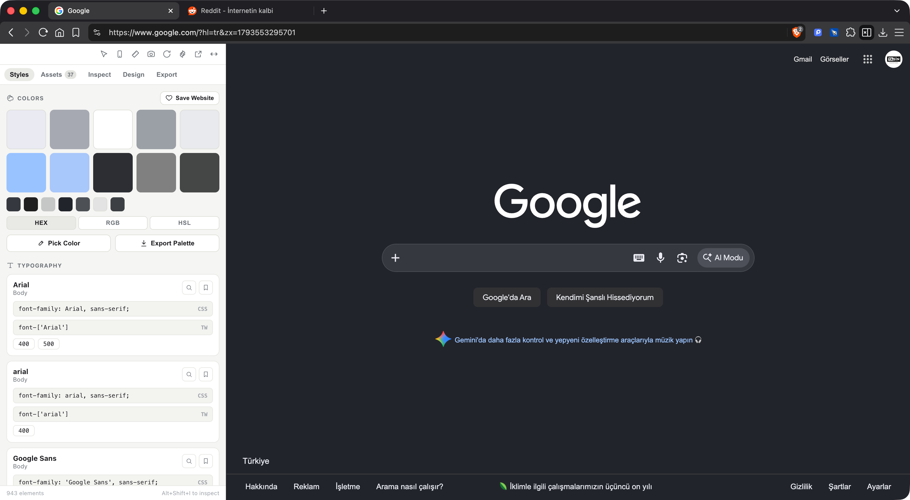
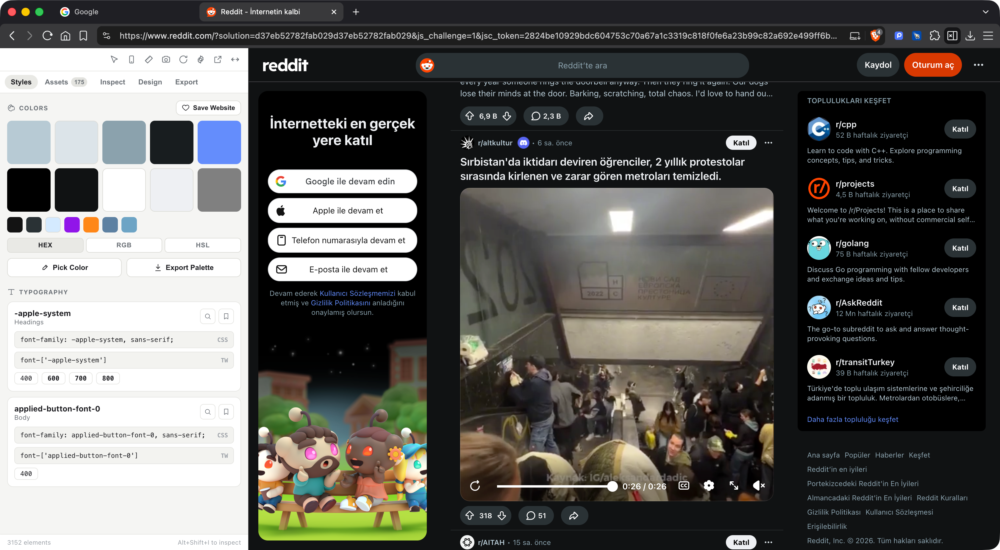
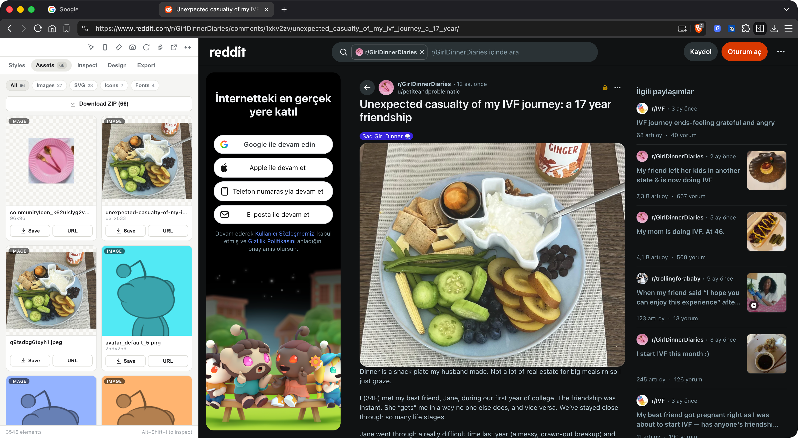
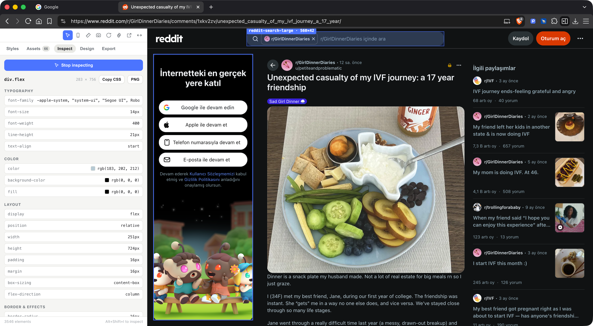
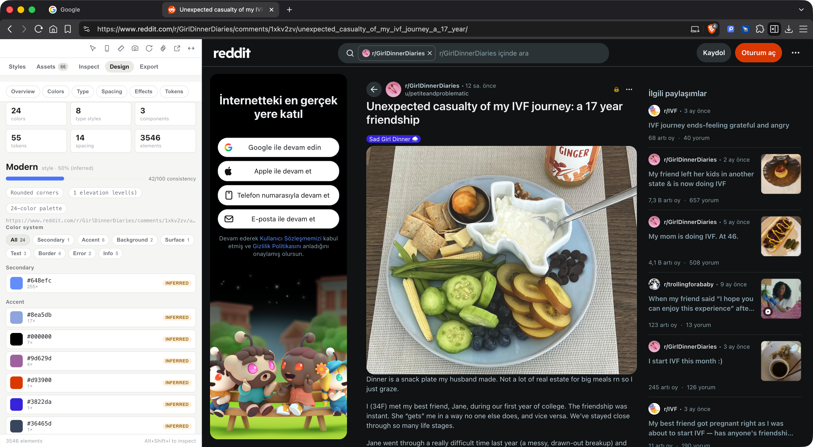
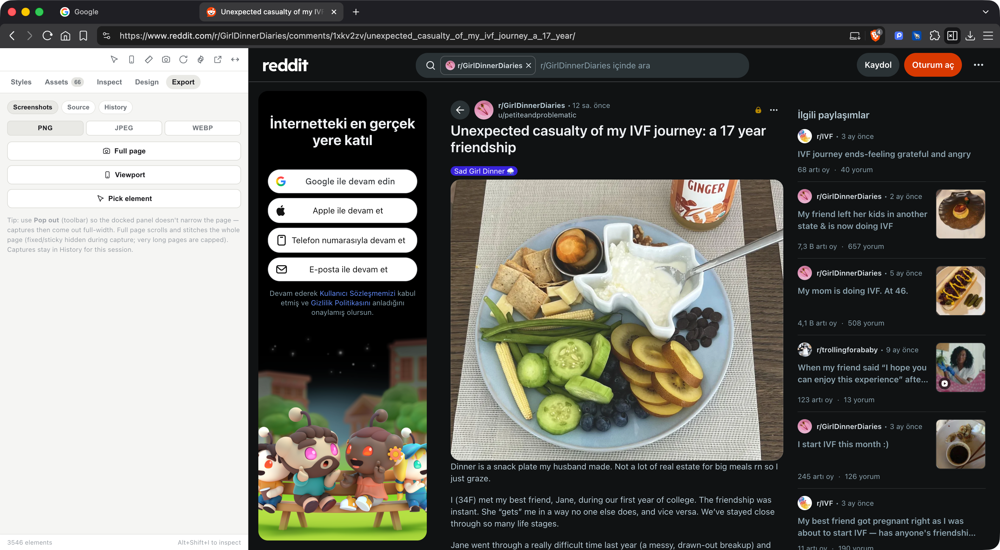

# Peeko

**Peeko** is a **local-first, zero-backend, open-source** browser extension (Manifest V3, Chrome + Firefox) that turns any web page into a design-inspection workbench. Pull **CSS, colors, fonts, assets and design tokens**, reverse-engineer a site's **design system**, simulate devices, measure, and **capture** full-page screenshots or a faithful page snapshot — all in a side panel.

There are **no accounts, no login, and no server**. Every operation runs in your browser; the extension never sends your data anywhere. The only outbound traffic is downloading assets **you** explicitly chose — and those URLs already belong to the page you're on.

---

## What it does

Peeko lives in the browser **side panel** (Chrome `sidePanel` / Firefox `sidebarAction`) with five tabs — **Styles · Assets · Inspect · Design · Export** — plus a toolbar for the device simulator, ruler, screenshots, settings and **Pop out**. It runs on any site (the examples below are Google and Reddit), fully in light **and** dark themes.

### 🎨 Styles — colors & typography at a glance



The **Styles** tab extracts the page's real visual language the moment you open it:

- **COLORS** — the dominant palette by usage, as copy-on-click swatches. Toggle **HEX / RGB / HSL** to copy in your preferred format. **Pick Color** samples any pixel on screen with the native eyedropper; **Export Palette** downloads the colors as CSS variables.
- **TYPOGRAPHY** — every font family actually used on the page, with its weights and ready-to-paste **CSS** and **Tailwind** snippets (one-click copy).
- The footer shows the live element count and the inspect shortcut.

It works on anything — here's the same tab on a dense, real-world app:



### 🗂️ Assets — extract & download everything



The **Assets** tab scans the page for **images, SVG, icons, video, Lottie and fonts**, filterable by type with live counts. Each asset has a preview (transparency shown on a checkerboard), its dimensions, **copy URL** and **single download** (into a `Peeko/` folder, fonts under `Peeko/fonts/`). **Download ZIP** bundles the whole current filter at once (cross-origin assets are fetched where allowed and the rest are skipped gracefully).

### 🔍 Inspect — read any element's computed styles



Click **Inspect**, hover the page (an isolated Shadow-DOM highlight tracks the element with a size label), and pick anything. Peeko reads its `getComputedStyle` grouped into **Typography · Color · Layout · Border & Effects**, each value one click to copy — plus **Copy CSS** for the whole rule and **PNG** to screenshot just that element. Keyboard shortcut: **Alt + Shift + I**. Restricted pages (`chrome://`, etc.) are handled with a polite message instead of failing.

### 🧩 Design — a full Design System Inspection tool



The **Design** tab reverse-engineers the site's design system, not just a color list:

- **Overview** — stat tiles (colors, type styles, components, tokens, spacing, elements), an inferred **design style** ("Modern") with a **consistency score**, and key characteristics.
- **Color system** — colors categorized into **Primary / Secondary / Accent / Background / Surface / Text / Border / Semantic** with a group filter, usage counts, near-duplicate flags, and WCAG contrast. Click a swatch for a full inspector (HEX/RGB/HSL/CSS-var, contrast on light & dark).
- **Typography / Spacing / Effects / Tokens** — a live type scale, extracted **and** normalized spacing, radii/shadows/motion previews, and a central token table.
- **Origin badges** everywhere — **Extracted** (read directly), **Inferred** (classified, with confidence) or **Normalized** (snapped to a scale) — so an inference is never shown as a certainty.
- **Export** to **CSS, SCSS, JSON (W3C DTCG), Tailwind v4, Markdown, Figma (Tokens Studio)** and an **AI Agent Brief** — an LLM-ready Markdown report an agent can use to rebuild the design.

### 📸 Export — screenshots & a faithful page snapshot



The **Export** tab is an independent capture module:

- **Screenshots** — **Full page** (scroll-and-stitch of the whole page; the navbar is kept once at the top and fixed/sticky elements are hidden afterwards so they don't repeat), **Viewport**, and **Pick element**, in **PNG / JPEG / WebP**. Captures collect in a session **History** (preview, size, download, remove).
- **Source** — **Save snapshot (.html)**: a self-contained, offline-faithful copy of the page with CSS, images (incl. `srcset`/lazy) and fonts inlined and scripts removed.
- 💡 Use **Pop out** (toolbar) to detach the panel into its own window so the docked panel doesn't narrow the page — captures then come out full-width.

### Plus

- **Device simulator** — open the page in a device-sized window (phone/tablet/desktop/watch, portrait/landscape).
- **Ruler** — drag to measure distances in pixels with crosshair guides.
- **Settings** — theme (system / light / **dark**), default color format, download-folder name, default export format — stored on-device only.

---

## Privacy, in one line

Local-first, zero telemetry. Peeko makes **no network requests of its own** and ships **no analytics** — verifiable in DevTools' Network tab. User preferences live in `chrome.storage.local`; nothing syncs or leaves your device.

---

## Install (unpacked)

1. `pnpm install && pnpm build` (Chrome) or `pnpm build:firefox`.
2. Chrome/Brave: open `chrome://extensions`, enable **Developer mode**, **Load unpacked**, and select `.output/chrome-mv3`.
3. Firefox: `about:debugging` → **This Firefox** → **Load Temporary Add-on** → pick `.output/firefox-mv2/manifest.json`.
4. Pin Peeko and click it to open the side panel (or press **Alt + Shift + I** to start inspecting).

## Develop

```bash
pnpm install
pnpm dev            # Chrome with HMR     ·   pnpm dev:firefox
pnpm check          # lint + typecheck + unit tests
pnpm build          # → .output/chrome-mv3 ·   pnpm build:firefox
pnpm zip            # packaged artifact    ·   pnpm zip:firefox
```

## Architecture (in short)

Three isolated contexts — the **side panel** (React UI), the **background service worker** (message relay with inject-and-retry + `RestrictedTabError`, downloads, screenshots) and **content scripts** (the per-frame inspection/extraction engine, with Shadow-DOM overlays). Pure logic (color/format conversions, token exporters, classification, capture math) is unit-tested; DOM-heavy code is verified by smoke tests. See [`docs/architecture/ARCHITECTURE.md`](docs/architecture/ARCHITECTURE.md).

## Tech stack

[WXT](https://wxt.dev) · React · TypeScript · Vite · JSZip · ESLint + Prettier · Vitest · Playwright (E2E scaffold) · pnpm.

## Documentation

| Area               | Document                                                                                                                                                                                        |
| ------------------ | ----------------------------------------------------------------------------------------------------------------------------------------------------------------------------------------------- |
| **Agent guidance** | [`AGENTS.md`](AGENTS.md)                                                                                                                                                                        |
| **Product**        | [`PRD`](docs/product/PRD.md) · [`ROADMAP`](docs/product/ROADMAP.md) · [`ACCEPTANCE_CRITERIA`](docs/product/ACCEPTANCE_CRITERIA.md)                                                              |
| **Architecture**   | [`ARCHITECTURE`](docs/architecture/ARCHITECTURE.md) · [`TECHNICAL_DESIGN`](docs/architecture/TECHNICAL_DESIGN.md) · [`DECISIONS`](docs/architecture/DECISIONS.md)                               |
| **Engineering**    | [`API_SPEC`](docs/engineering/API_SPEC.md) · [`DATABASE`](docs/engineering/DATABASE.md) · [`CODING_STANDARDS`](docs/engineering/CODING_STANDARDS.md) · [`TESTING`](docs/engineering/TESTING.md) |
| **Operations**     | [`DEPLOYMENT`](docs/operations/DEPLOYMENT.md) · [`SECURITY`](docs/operations/SECURITY.md) · [`OBSERVABILITY`](docs/operations/OBSERVABILITY.md)                                                 |
| **Planning**       | [`TASKS`](docs/planning/TASKS.md)                                                                                                                                                               |

> `API_SPEC.md` documents the **internal typed message protocol** (there is no HTTP API). `DATABASE.md` documents the **`chrome.storage.local` preference schema** (there is no database).

## License

[MIT](LICENSE) © Yasin Karateke.
